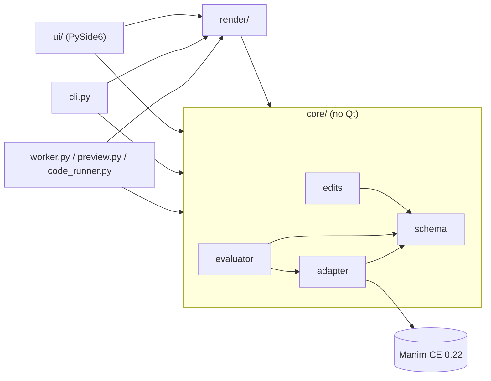
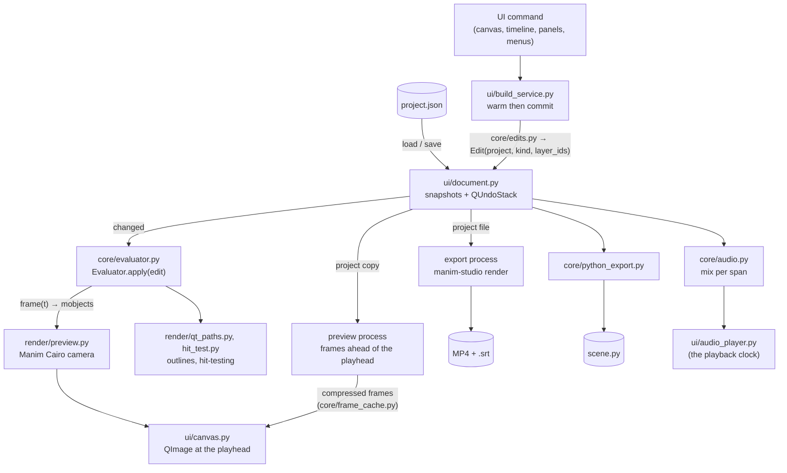

# Architecture

Manim Studio is a desktop editor where you animate visually - objects, a timeline of clips,
keyframes - and **Manim Community Edition 0.22** does the rendering. This page is the map of
the code as it is today; the *why* behind each rule is in the [ADRs](adr/README.md), the file
format in [project-format.md](project-format.md), and the history in the
[roadmap](roadmap.md) and [changelog](../CHANGELOG.md).

## The idea in one paragraph

Manim's `Scene.play()` is just a loop: `begin()`, then `interpolate(t / run_time)` every frame,
then `finish()`. The editor runs that loop itself, driven by the timeline, so it can compute
**any frame at any time in any order** from a JSON document. Preview and export use the same
evaluator and the same Manim Cairo renderer, so what you see is what you export
([ADR 0002](adr/0002-editor-owns-manims-clock.md),
[ADR 0006](adr/0006-preview-renders-with-manims-cairo-camera.md)).

## Layers of the code

### Rules (checked in review and by tests)

1. **`core/` never imports Qt or `ui/`.** It stays usable headless: the CLI, tests, the helper
   processes and exported exact scenes all run it.
2. **`core/adapter.py` is the only module that knows Manim's API** - which classes build which
   object types, the clip registry and allow-list, easing, and the patches to Manim internals
   (ADR 0003, 0007). Other modules use generic `Mobject` APIs (`copy`, `get_family`, points,
   colours) and generic containers; the evaluator also makes its placeholders and groups from a
   few concrete classes.
3. **A frame is a pure function of `(project, t)`.** Never mutate a checkpoint, a base mobject or
   anything `Evaluator.frame()` returns.
4. **Every change is an edit.** Functions in `core/edits.py` return a validated snapshot plus an
   *edit kind* computed by diffing; `Evaluator.apply(edit)` drops only the caches that kind can
   affect (ADR 0008, 0013). In the UI every edit goes through `Document` (undo) and, when it builds
   a cold text object, through the build service (ADR 0014, 0015).
5. `render/` may import `core/`; `ui/` may import everything. Only `render/qt_paths.py` in
   `render/` touches Qt (to make `QPainterPath`s).
6. Everything logs through `logging_config.get_logger(__name__)` (ADR 0011).

## Data flow

### Processes

| process | started by | what it does | ADR |
|---|---|---|---|
| **build worker** `python -m manim_studio.worker` | `ui/worker_process.py` | builds new Text/Tex/MathTex objects (0.5-1.3 s each the first time) into Manim's disk cache, and tries new Python object code first; the edit commits once the editor's own build is a cache hit. Restarted on a 20 s timeout or a crash. | [0015](adr/0015-build-worker-warm-then-commit.md), [0051](adr/0051-python-objects.md) |
| **preview process** `python -m manim_studio.preview` | `ui/preview_client.py` | holds its own copy of the project and renders frames ahead of the playhead with the canvas's camera; the editor keeps them compressed and drops only the frames an edit changes | [0028](adr/0028-render-ahead-cache.md) |
| **code runner** `manim_studio.code_runner` | `ui/code_render.py` | plays a code layer's `Scene` once in a single-use process into the code layer frame cache (warm spares are kept ready) | [0019](adr/0019-code-layers.md) |
| **export** `manim-studio render --progress json` | `ui/export_job.py` | renders a video while the editor keeps working; an existing file is replaced only when complete | [0017](adr/0017-export-process-and-safe-output.md) |

Each helper can be turned off for tests and debugging: `MANIM_STUDIO_WORKER=0` (build
synchronously), `MANIM_STUDIO_PREVIEW=0`, `MANIM_STUDIO_CODE=0`, `MANIM_STUDIO_AUDIO=0`.

## Module map

Paths are under `src/manim_studio/`; tests under `tests/`.

### Entry points and processes

| path | responsibility | key tests |
|---|---|---|
| `cli.py` | `manim-studio render \| python \| edit`, `--version` | `render/test_export.py`, `test_version.py` |
| `worker.py` | build worker (warms text, tries Python objects) | `test_worker_messages.py`, `ui/test_worker_process.py` |
| `preview.py` | preview render process | `ui/test_preview_process.py` |
| `code_runner.py` | renders a code layer's scene into its frame cache | `test_code_runner.py` |
| `manim_scene.py` | `StudioScene`: exported exact scenes play the project through the evaluator | `core/test_python_export.py` |
| `plugins.py` | public plugin API: `ObjectType`, `Param`, `register`, plugin folders and entry points | `core/test_plugins.py` |
| `logging_config.py` | console and rotating file logging | `test_logging.py` |

### `core/` - the model and the engine (no Qt)

| path | responsibility | key tests |
|---|---|---|
| `schema.py` | the project document (pydantic): Project, Layer, Clip, keys, canvas, camera, sounds, cues, markers; validation; clip kind info; lifetime inference | `core/test_schema.py`, `core/test_lifetime.py` |
| `edits.py` | every edit: a validated snapshot plus its edit kind (timing / transform / clip / spec) | `core/test_edits.py`, `core/test_invalidation.py`, `core/test_properties.py` |
| `evaluator.py` | `frame(t)`: checkpoints, active clips, keyframes, morphs, parts and child trees, simulations, `invalidate` | `core/test_random_access.py`, `core/test_transforms.py` |
| `adapter.py` | the only Manim-aware module: builders, object library, clip registry and allow-list, easing, patches, Python object builds | `core/test_adapter.py`, `core/test_registry.py`, `core/test_clip_kinds.py` |
| `layer_index.py` | the layer tree indexed once per snapshot (O(1) tree questions) | `core/test_layer_index.py` |
| `parts.py` | part layers: TeX keys to spans, split into terms | `core/test_parts.py`, `core/test_part_layers.py` |
| `motion_paths.py` | curved position paths between keys | `core/test_motion_paths.py` |
| `expressions.py` | graph formulas: a whitelist over Python's syntax tree, never `eval` | `core/test_graphs.py` |
| `placement.py` | where a new object goes so it covers nothing | `core/test_placement.py` |
| `scene_length.py` | the scene's length: by hand or growing with its content | `core/test_scene_length.py` |
| `shift_timing.py` | moving layers, clips, keys, sounds, cues, markers by one delta | `core/test_shift_timing.py` |
| `clipboard.py` | copy, paste, duplicate: subtrees with fresh ids | `core/test_clipboard.py` |
| `library.py` | presets, themes, templates: library files and applying them | `core/test_library.py` |
| `warm.py` | which edits build cold text objects (the warm gate) | `core/test_warm.py` |
| `frame_cache.py` | preview frames: the fps grid, spans an edit changes, the frame store | `core/test_frame_cache.py` |
| `code_cache.py`, `code_frame.py` | code layer frames: storage, eviction, drawn as a mobject | `core/test_code_cache.py`, `core/test_code_layers.py` |
| `trust.py` | which code may run: sha256 hashes in a per-user store | `core/test_code_layers.py`, `core/test_python_objects.py` |
| `python_object.py`, `python_templates.py` | Python objects: `PARAMS` read without running, values, trust, time limit; templates | `core/test_python_objects.py`, `core/test_python_templates.py` |
| `python_export.py` | the project as Manim code, readable or exact, and why | `core/test_python_export.py`, `core/test_python_export_keyed.py` |
| `audio.py` | sounds: decoding on demand, peaks, the mix per span | `core/test_audio.py`, `core/test_audio_spans.py` |
| `subtitles.py` | wrapping, `.srt` read/write, placing cues, changed spans | `core/test_subtitles.py` |
| `tables.py`, `levels.py` | the Audio page's cells and level meter, without Qt | `core/test_tables.py`, `core/test_levels.py` |
| `recovery.py` | recovery copies of unsaved work | `core/test_recovery.py` |

### `render/` - frames out

| path | responsibility | key tests |
|---|---|---|
| `preview.py` | the camera shared by the canvas, the preview process and the export (2D, or `ThreeDCamera` when turned) | `core/test_camera.py`, `ui/test_preview_process.py` |
| `cairo_export.py` | Manim's Cairo camera to frames to PyAV/libx264 with the mix and `.srt` | `render/test_export.py` |
| `options.py` | render options: size, fps, range, crf, subtitles | `render/test_options.py` |
| `qt_paths.py` | Manim geometry as `QPainterPath` (outlines) | `render/test_qt_paths.py` |
| `hit_test.py` | which layers are under a canvas point | `render/test_hit_test.py` |
| `preset_thumbs.py` | a preset drawn on a square, 8 frames | `render/test_preset_thumbs.py` |

### `ui/` - the editor (PySide6)

| path | responsibility | key tests |
|---|---|---|
| `main_window.py` | menus, transport, playback and idle scheduling, wiring | `ui/test_main_window.py`, `ui/test_golden_path.py` |
| `document.py` | current snapshot, `QUndoStack`, drag previews | `ui/test_document.py` |
| `build_service.py` | every panel edit: now, or after the worker warmed it | `ui/test_build_service.py` |
| `selection.py` | the one selection shared by every view | `ui/test_selection.py` |
| `pages/` | Compose, Animate, Code, Audio, Deliver; `PageHost` moves the shared views | `ui/test_pages.py`, `ui/test_animate_page.py`, `ui/test_code_page.py`, `ui/test_audio_page.py`, `ui/test_deliver_page.py` |
| `canvas.py`, `canvas_tools.py` | the frame at the playhead; select, move, scale, rotate, nudge, stopwatch and auto-key | `ui/test_canvas_tools.py` |
| `gizmo.py`, `param_handles.py`, `snap_guides.py`, `arrange.py`, `viewport.py`, `motion_overlay.py` | pure canvas geometry: handles, snapping, align/distribute, zoom/pan, motion paths | `ui/test_gizmo.py`, `ui/test_param_handles.py`, `ui/test_snap_guides.py`, `ui/test_arrange.py`, `ui/test_viewport.py` |
| `timeline/model.py`, `timeline/view.py` | timeline geometry and drag rules (pure); the widget: rows, property rows, multi-select | `ui/test_timeline_model.py`, `ui/test_timeline_view.py`, `ui/test_property_rows.py`, `ui/test_timeline_multiselect.py` |
| `graph_model.py`, `graph_editor.py`, `curve_editor.py` | the Animate page's graph (pure rules, widget); the easing curve editor | `ui/test_graph_model.py`, `ui/test_curve_editor.py` |
| `layers_panel.py`, `properties_panel.py`, `fields.py` | the Layers and Properties panels | `ui/test_layers_panel.py`, `ui/test_properties_panel.py` |
| `render_ahead.py`, `preview_client.py`, `worker_process.py`, `code_render.py` | clients of the helper processes | `ui/test_render_ahead.py`, `ui/test_worker_process.py`, `ui/test_code_render.py` |
| `export_job.py`, `export_dialog.py`, `render_queue.py` | exports: one process, the dialog, the Deliver queue | `ui/test_export_job.py`, `ui/test_export_dialog.py`, `ui/test_render_queue.py` |
| `audio_player.py` | plays the mix; its clock drives playback | `ui/test_audio_ui.py` |
| `clipboard_actions.py`, `autosave.py` | Edit > Cut/Copy/Paste/Duplicate; recovery copies every 30 s | `ui/test_clipboard_ui.py`, `ui/test_autosave.py` |
| `code_editor.py`, `code_syntax.py`, `code_drafts.py` | the Code page's editor, lexer and drafts | `ui/test_code_syntax.py`, `ui/test_code_page.py` |
| `preferences.py`, `places.py`, `welcome.py` | the settings file; where files are kept and suggested; the welcome panel | `ui/test_preferences.py`, `ui/test_places.py` |
| `presets_browser.py`, `shortcuts_help.py`, `plugins_dialog.py` | Animate > Browse Presets, Help > Keyboard Shortcuts, Help > Plugins | `ui/test_presets_browser.py`, `ui/test_shortcuts_help.py`, `ui/test_plugins_ui.py` |
| `theme.py`, `icons.py`, `elided_label.py` | design tokens, stylesheet, contrast; icons; eliding label | `ui/test_theme.py`, `ui/test_layout_checks.py` |

## Core concepts

| concept | meaning | where |
|---|---|---|
| Layer | one object: a spec (type + params + style), base transform, keyframe tracks, a lifetime, one clip lane; list order = z-order | ADR 0004 |
| Part / child | a layer under another: a term of an equation (part), a graph or object on axes (child) - evaluated with its root | ADR 0012, 0024, 0029, 0030 |
| Group | a layer that draws nothing; its transform carries its objects | ADR 0050 |
| Clip | a Manim animation on a layer's lane; categories content / emphasis / motion / morph; overlay clips draw beside the object | ADR 0004, 0005, 0022 |
| Keyframes | position, scale, rotation, opacity tracks applied after clips; the stopwatch and auto-key rules | ADR 0004, 0018 |
| Checkpoint | cached state of a layer after a clip | ADR 0002 |
| Edit kind | timing / transform / clip / spec, computed by `core/edits.py` - decides what `Evaluator.apply` drops | ADR 0008, 0013 |
| Allow-list | clip kinds x object types verified random-access-safe | ADR 0007, 0022 |
| Warm key | disk-cache identity of a text object; an edit building a cold key waits for the worker | ADR 0015 |
| Media signature | a file's modification time and size (or a Python object's trust state); a change rebuilds the layer when `Evaluator.check_media` runs | ADR 0027, 0051 |
| Trust | code (code layers, Python objects) runs only when its hash is in the user's store | ADR 0019, 0051 |
| Camera | the flat 2D view by default; any other angle renders with `ThreeDCamera` | ADR 0048 |

## Performance budget

30 fps playback = 33 ms per frame for evaluate + render; kept frames from the preview process
make playback independent of scene cost once rendered. Every number, and how it was measured, is
in [logs/benchmarks.md](logs/benchmarks.md) (B1, B2, ...); the scripts are in
[benchmarks/](../benchmarks/README.md).

## Known limitations

- Parts exist only for MathTex/Tex terms; other objects animate whole (ADR 0012).
- Media paths are absolute, and the elements of an SVG cannot be animated separately (ADR 0027).
- Object parameters (a rectangle's width) are not keyable; only the transform is.
- Groups carry a transform only: no clips on a group, no nested groups (ADR 0050).
- No 3D objects: the camera only views the flat scene from an angle (ADR 0048). Updaters beyond
  traced paths, connectors, counting numbers and plugin simulations need code layers.
- `qt_paths` does not draw `ImageMobject` (only needed for hit-testing).
- Deliberate differences from vanilla Manim: [deviations.md](deviations.md).
