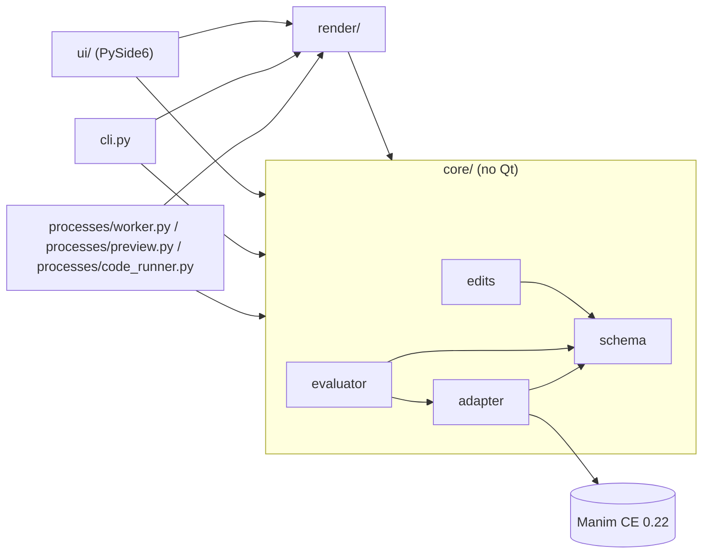
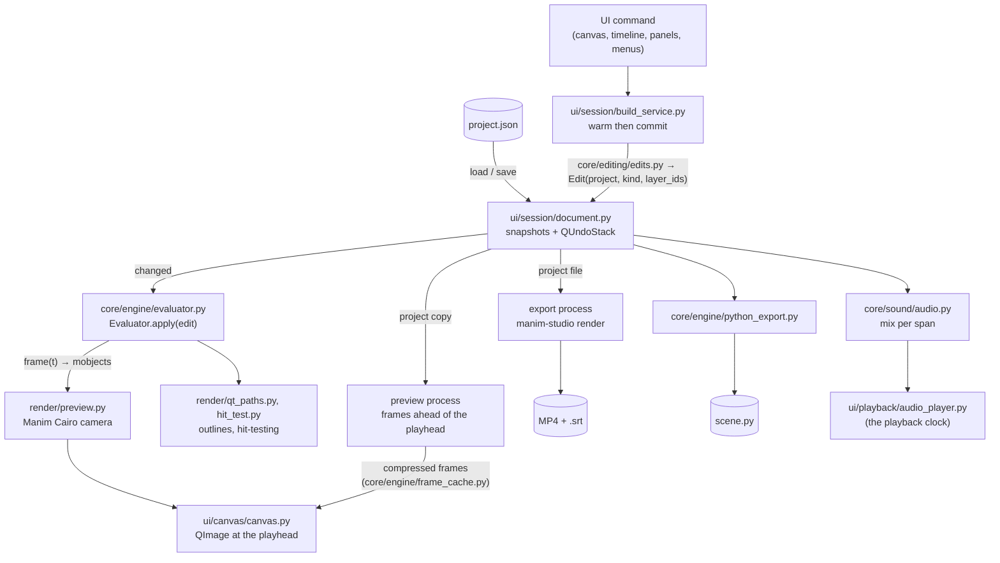

# Architecture

Manim Studio is a desktop editor where you animate visually - objects, a timeline of clips,
keyframes - and **Manim Community Edition 0.22** does the rendering. This page is the map of
the code as it is today; the *why* behind each rule is in the [ADRs](adr/README.md), the file
format in [project-format.md](project-format.md), and the history in the
[roadmap](roadmap.md) and [changelog](../CHANGELOG.md).

## The idea in one paragraph

Manim's `Scene.play()` is just a loop: `begin()`, then `interpolate(t / run_time)` every frame,
then `finish()`. The editor runs that loop itself, driven by the timeline, so it can compute
**any frame at any time in any order** from a JSON document. Preview and export use the same
evaluator and the same Manim Cairo renderer, so what you see is what you export
([ADR 0002](adr/0002-editor-owns-manims-clock.md),
[ADR 0006](adr/0006-preview-renders-with-manims-cairo-camera.md)).

## Layers of the code

### Rules (checked in review and by tests)

1. **`core/` never imports Qt or `ui/`.** It stays usable headless: the CLI, tests, the helper
   processes and exported exact scenes all run it.
2. **`core/engine/adapter.py` is the only module that knows Manim's API** - which classes build which
   object types, the clip registry and allow-list, easing, and the patches to Manim internals
   (ADR 0003, 0007). Other modules use generic `Mobject` APIs (`copy`, `get_family`, points,
   colours) and generic containers; the evaluator also makes its placeholders and groups from a
   few concrete classes.
3. **A frame is a pure function of `(project, t)`.** Never mutate a checkpoint, a base mobject or
   anything `Evaluator.frame()` returns.
4. **Every change is an edit.** Functions in `core/editing/edits.py` return a validated snapshot plus an
   *edit kind* computed by diffing; `Evaluator.apply(edit)` drops only the caches that kind can
   affect (ADR 0008, 0013). In the UI every edit goes through `Document` (undo) and, when it builds
   a cold text object, through the build service (ADR 0014, 0015).
5. `render/` may import `core/`; `ui/` may import everything. Only `render/qt_paths.py` in
   `render/` touches Qt (to make `QPainterPath`s).
6. Everything logs through `logging_config.get_logger(__name__)` (ADR 0011).

### Packages

The code is grouped by what it does ([ADR 0062](adr/0062-package-layout.md)); a package imports only from a
lower rank, and `tests/test_architecture.py` fails when it does not. Within `core/` and `ui/`, a lower rank is
nearer the top of each table.

| `core/` | rank | holds |
|---|---|---|
| `model/` | 0 | the project document and the rules that need nothing else: schema, layer index, parts, shapes, glyph colours, recovery copies |
| `code/`, `sound/` | 1 | running and keeping the user's code (frame cache, trust, helpers, Python objects, limits, chapters); sound and subtitles |
| `exchange/`, `editing/` | 2 | code in and out (files, presets, imported scenes); changing a project (edits, clipboard, library items, equation steps, the Audio page's tables) |
| `assist/`, `voice/` | 3 | help while code is typed: completion, hints, diagnostics, snippets, outline, run to cursor; narration: voices for the subtitles, their sounds, keeping them in step |
| `engine/` | 4 | Manim: adapter, evaluator, morphs, frame cache, Python export, the warm gate, placement |

| `ui/` | rank | holds |
|---|---|---|
| `style/` | 0 | colour tokens, icons, field widgets, the run-activity cue |
| `services/` | 1 | the editor's side of its helper processes: worker, preview, code renders, helper checks, voices |
| `session/`, `deliver/` | 2 | the document and its undo, the selection, the build service, settings; video export and the render queue |
| `timeline/`, `canvas/` | 3 | the timeline and the graph editor; the canvas, gizmos, handles, snapping |
| `playback/`, `panels/`, `code/`, `shell/` | 4 | audio and the presenter; docks that edit the selection; the Code workspace; pieces of the main window |
| `exchange/` | 5 | the import and export windows |
| `pages/` | 6 | the workspace pages; `main_window.py` sits on top and reaches every layer |

Outside the packages: `render/` (frames out; core only), `processes/` (what the editor starts with
`python -m`), `data/` (files that ship with the package), and at the top the names other things were written
against: `cli.py`, `manim_scene.py` (exported scenes import it), `plugins.py` (the plugin API) and
`logging_config.py`.

## Data flow

### Processes

| process | started by | what it does | ADR |
|---|---|---|---|
| **build worker** `python -m manim_studio.processes.worker` | `ui/services/worker_process.py` | builds new Text/Tex/MathTex objects (0.5-1.3 s each the first time) into Manim's disk cache, and tries new Python object code first; the edit commits once the editor's own build is a cache hit. Restarted on a 20 s timeout or a crash. | [0015](adr/0015-build-worker-warm-then-commit.md), [0051](adr/0051-python-objects.md) |
| **preview process** `python -m manim_studio.processes.preview` | `ui/services/preview_client.py` | holds its own copy of the project and renders frames ahead of the playhead with the canvas's camera; the editor keeps them compressed and drops only the frames an edit changes | [0028](adr/0028-render-ahead-cache.md) |
| **code runner** `manim_studio.processes.code_runner` | `ui/services/code_render.py` | plays a code layer's `Scene` once in a single-use process into the code layer frame cache (warm spares are kept ready) | [0019](adr/0019-code-layers.md) |
| **voice helper** `python -m manim_studio.processes.voice` | `ui/services/voice_client.py` (and `manim-studio narrate`) | lists a voice provider's voices and speaks texts to files; a provider is a plugin and never runs in the editor. Killed on cancel or when it goes quiet for 3 minutes; retries what a provider calls retryable. | [0060](adr/0060-voice-providers-and-narration.md) |
| **export** `manim-studio render --progress json` | `ui/deliver/export_job.py` | renders a video while the editor keeps working; an existing file is replaced only when complete | [0017](adr/0017-export-process-and-safe-output.md) |

Each helper can be turned off for tests and debugging: `MANIM_STUDIO_WORKER=0` (build
synchronously), `MANIM_STUDIO_PREVIEW=0`, `MANIM_STUDIO_CODE=0`, `MANIM_STUDIO_AUDIO=0`.

**Lifetime and memory** ([ADR 0064](adr/0064-helper-lifetime-and-memory.md)). A helper is a Python with Manim
loaded, about 120 MB, and none outlives the editor: on Windows each is put in a job object that the system closes
with the editor's process; each also watches the editor that started it (`MANIM_STUDIO_EDITOR_PID`,
`lifeline.die_with_editor()`), which covers other platforms and a helper stuck in user code that never reads its
input; and `ui/services/children.py` ends what is left, with the processes it started, when the application
quits. A helper starts when there is work for it (the welcome page runs none) and the build worker, the frame
renderer and the code runner's ready spare are released after ten minutes without work
(`MANIM_STUDIO_IDLE_SECONDS`; `0` keeps them). numpy's thread pools are capped at one thread in every process
(`MANIM_STUDIO_NATIVE_THREADS`), because each thread reserves memory the moment numpy loads.

## Module map

Paths are under `src/manim_studio/`; tests under `tests/`.

### Entry points and processes

| path | responsibility | key tests |
|---|---|---|
| `cli.py` | `manim-studio render \| python \| import \| narrate \| edit`, `--version` | `render/test_export.py`, `test_version.py`, `test_narrate_cli.py` |
| `processes/worker.py` | build worker (warms text, tries Python objects) | `processes/test_worker_messages.py`, `ui/services/test_worker_process.py` |
| `processes/preview.py` | preview render process | `ui/services/test_preview_process.py` |
| `processes/code_runner.py` | renders a code layer's scene into its frame cache | `processes/test_code_runner.py` |
| `processes/voice.py` | the voice helper: lists voices, speaks texts (also `run_job` for the command line) | `processes/test_voice_process.py` |
| `manim_scene.py` | `StudioScene`: exported exact scenes play the project through the evaluator | `core/engine/test_python_export.py` |
| `plugins.py` | public plugin API: `ObjectType`, `Simulation`, `VoiceProvider`, `Param`, `register`, plugin folders and entry points | `test_plugins.py` |
| `plugin_manifest.py` | plugin manifests, app version ranges, permission approvals (ADR 0078); pure | `test_plugin_manifest.py` |
| `logging_config.py` | console and rotating file logging | `test_logging.py` |
| `lifeline.py` | helpers end with the editor (job object, watcher, `kill_tree`) and numpy's thread pools stay small | `test_lifeline.py`, `test_editor_lifetime.py` |

### `core/` - the model and the engine (no Qt)

| path | responsibility | key tests |
|---|---|---|
| `model/schema.py` | the project document (pydantic): Project, Layer, Clip, keys, canvas, camera, sounds, cues, markers, Code page folders; validation; clip kind info; lifetime inference | `core/model/test_schema.py`, `core/model/test_lifetime.py` |
| `editing/edits.py` | every edit: a validated snapshot plus its edit kind (timing / transform / clip / spec), including Code page folder operations | `core/editing/test_edits.py`, `core/engine/test_invalidation.py`, `core/editing/test_properties.py` |
| `engine/evaluator.py` | `frame(t)`: checkpoints, active clips, keyframes, morphs, parts and child trees, simulations, `invalidate` | `core/engine/test_random_access.py`, `core/engine/test_transforms.py` |
| `engine/adapter.py` | the only Manim-aware module: builders, object library, clip registry and allow-list, easing, patches, Python object builds | `core/engine/test_adapter.py`, `core/engine/test_registry.py`, `core/features/test_clip_kinds.py` |
| `model/layer_index.py` | the layer tree indexed once per snapshot (O(1) tree questions) | `core/model/test_layer_index.py` |
| `model/parts.py` | part layers: TeX keys to spans, split into terms | `core/model/test_parts.py`, `core/model/test_part_layers.py` |
| `model/motion_paths.py` | curved position paths between keys | `core/model/test_motion_paths.py` |
| `model/expressions.py` | graph formulas: a whitelist over Python's syntax tree, never `eval` | `core/features/test_graphs.py` |
| `engine/placement.py` | where a new object goes so it covers nothing | `core/engine/test_placement.py` |
| `model/scene_length.py` | the scene's length: by hand or growing with its content | `core/model/test_scene_length.py` |
| `editing/shift_timing.py` | moving layers, clips, keys, sounds, cues, markers by one delta | `core/editing/test_shift_timing.py` |
| `editing/sequences.py` | compound sequences: named clips and keys moved, retimed, copied together (ADR 0079) | `core/editing/test_sequences.py` |
| `editing/recipes.py` | editable animation recipes: a sequence's animation applied to other layers as a new sequence (ADR 0080) | `core/editing/test_recipes.py` |
| `editing/clipboard.py` | copy, paste, duplicate: subtrees with fresh ids | `core/editing/test_clipboard.py` |
| `editing/library.py` | presets, themes, templates: library files and applying them | `core/editing/test_library.py` |
| `engine/warm.py` | which edits build cold text objects (the warm gate) | `core/engine/test_warm.py` |
| `engine/frame_cache.py` | preview frames: the fps grid, spans an edit changes, the frame store | `core/engine/test_frame_cache.py` |
| `code/code_cache.py`, `code/code_frame.py` | code layer frames: storage, eviction, drawn as a mobject | `core/code/test_code_cache.py`, `core/code/test_code_layers.py` |
| `code/trust.py` | which code may run: sha256 hashes in a per-user store | `core/code/test_code_layers.py`, `core/code/test_python_objects.py` |
| `code/python_object.py`, `code/python_templates.py` | Python objects: `PARAMS` read without running, values, trust, time limit; templates | `core/code/test_python_objects.py`, `core/code/test_python_templates.py` |
| `model/shape.py` | Shape objects: an object frozen into plain vector data, and which layers can be frozen (P10.2, ADR 0052) | `core/model/test_shapes.py` |
| `editing/equation_steps.py` | equation steps: lines, a small LaTeX tokenizer, algebra operations and named functions on both sides, transition plans and highlight runs (P11, ADR 0054) | `core/editing/test_equation_steps.py`, `core/editing/test_equation_steps_layers.py` |
| `model/glyph_colours.py` | colour characters: a text's `glyph_colours` list (one colour per drawn glyph), gradients, rainbow, alternate, ranges, validation (ADR 0055) | `core/model/test_glyph_colour_helpers.py`, `core/model/test_glyph_colours.py` |
| `engine/morph.py` | smart morph matching: pieces paired by place/size/outline (Hungarian), holes with holes, loops started where they travel least and cut at each other's corners, OKLab colour blends, the gallery's measures; numpy only (ADR 0056) | `core/engine/test_morph.py`, `core/engine/test_morph_frames.py` |
| `engine/python_export.py` | the project as Manim code, readable or exact, and why | `core/engine/test_python_export.py`, `core/engine/test_python_export_keyed.py` |
| `sound/audio.py` | sounds: decoding on demand, peaks, the mix per span | `core/sound/test_audio.py`, `core/sound/test_audio_spans.py` |
| `sound/subtitles.py` | wrapping, `.srt` read/write, placing cues, changed spans | `core/sound/test_subtitles.py` |
| `voice/narration.py` | narration: a cue's key and state (new, stale, ready), what to speak, placing the speech, follow and fit, the script | `core/voice/test_narration.py` |
| `voice/retime.py` | Follow speech and Fit speech to cues | `core/voice/test_retime.py` |
| `voice/pronunciation.py`, `voice/voice_cache.py` | the pronunciation dictionary; where generated speech is kept | `core/voice/test_narration.py` |
| `voice/builtin_sapi.py`, `voice/builtin_edge.py` | the two built-in voice providers (Windows voices, Edge neural) | `processes/test_voice_process.py` (fake provider) |
| `editing/tables.py`, `sound/levels.py` | the Audio page's cells and level meter, without Qt | `core/editing/test_tables.py`, `core/sound/test_levels.py` |
| `model/recovery.py` | recovery copies of unsaved work | `core/model/test_recovery.py` |

### `render/` - frames out

| path | responsibility | key tests |
|---|---|---|
| `processes/preview.py` | the camera shared by the canvas, the preview process and the export (2D, or `ThreeDCamera` when turned) | `core/features/test_camera.py`, `ui/services/test_preview_process.py` |
| `cairo_export.py` | Manim's Cairo camera to frames to PyAV/libx264 with the mix and `.srt` | `render/test_export.py` |
| `options.py` | render options: size, fps, range, crf, subtitles | `render/test_options.py` |
| `qt_paths.py` | Manim geometry as `QPainterPath` (outlines) | `render/test_qt_paths.py` |
| `hit_test.py` | which layers are under a canvas point | `render/test_hit_test.py` |
| `preset_thumbs.py` | a preset drawn on a square, 8 frames | `render/test_preset_thumbs.py` |

### `ui/` - the editor (PySide6)

| path | responsibility | key tests |
|---|---|---|
| `main_window.py` | menus, transport, playback and idle scheduling, wiring | `ui/test_main_window.py`, `ui/test_golden_path.py` |
| `session/document.py` | current snapshot, `QUndoStack`, drag previews | `ui/session/test_document.py` |
| `session/build_service.py` | every panel edit: now, or after the worker warmed it | `ui/session/test_build_service.py` |
| `session/selection.py` | the one selection shared by every view | `ui/session/test_selection.py` |
| `pages/` | Compose, Animate, Code, Audio, Deliver; `PageHost` moves the shared views | `ui/pages/test_pages.py`, `ui/pages/test_animate_page.py`, `ui/code/test_code_page.py`, `ui/pages/test_audio_page.py`, `ui/pages/test_deliver_page.py` |
| `canvas/canvas.py`, `canvas/canvas_tools.py` | the frame at the playhead; select, move, scale, rotate, nudge, stopwatch and auto-key | `ui/canvas/test_canvas_tools.py` |
| `canvas/gizmo.py`, `canvas/param_handles.py`, `canvas/snap_guides.py`, `canvas/arrange.py`, `canvas/viewport.py`, `canvas/motion_overlay.py` | pure canvas geometry: handles, snapping, align/distribute, zoom/pan, motion paths | `ui/canvas/test_gizmo.py`, `ui/canvas/test_param_handles.py`, `ui/canvas/test_snap_guides.py`, `ui/canvas/test_arrange.py`, `ui/canvas/test_viewport.py` |
| `timeline/model.py`, `timeline/view.py` | timeline geometry and drag rules (pure); the widget: rows, property rows, multi-select | `ui/timeline/test_timeline_model.py`, `ui/timeline/test_timeline_view.py`, `ui/panels/test_property_rows.py`, `ui/timeline/test_timeline_multiselect.py` |
| `timeline/graph_model.py`, `timeline/graph_editor.py`, `timeline/curve_editor.py` | the Animate page's graph (pure rules, widget); the easing curve editor | `ui/timeline/test_graph_model.py`, `ui/timeline/test_curve_editor.py` |
| `panels/layers_panel.py`, `panels/properties_panel.py`, `style/fields.py` | the Layers and Properties panels | `ui/panels/test_layers_panel.py`, `ui/panels/test_properties_panel.py` |
| `services/render_ahead.py`, `services/preview_client.py`, `services/worker_process.py`, `services/code_render.py` | clients of the helper processes | `ui/services/test_render_ahead.py`, `ui/services/test_worker_process.py`, `ui/services/test_code_render.py` |
| `services/children.py` | starts every helper (environment, job object) and ends them all when the application quits | `ui/services/test_children.py`, `ui/services/test_idle_release.py` |
| `deliver/export_job.py`, `deliver/export_dialog.py`, `deliver/render_queue.py` | exports: one process, the dialog, the Deliver queue | `ui/deliver/test_export_job.py`, `ui/deliver/test_export_dialog.py`, `ui/deliver/test_render_queue.py` |
| `playback/audio_player.py` | plays the mix; its clock drives playback | `ui/playback/test_audio_ui.py` |
| `shell/clipboard_actions.py`, `shell/autosave.py` | Edit > Cut/Copy/Paste/Duplicate; recovery copies every 30 s | `ui/shell/test_clipboard_ui.py`, `ui/shell/test_autosave.py` |
| `code/code_editor.py`, `code/code_syntax.py`, `code/code_drafts.py` | the Code page's editor, lexer and drafts | `ui/code/test_code_syntax.py`, `ui/code/test_code_page.py` |
| `session/preferences.py`, `session/places.py`, `shell/welcome.py` | the settings file and per-project canvas framing; where files are kept and suggested; the welcome panel | `ui/session/test_preferences.py`, `ui/session/test_places.py` |
| `panels/presets_browser.py`, `shell/shortcuts_help.py`, `shell/plugins_dialog.py` | Animate > Browse Presets, Help > Keyboard Shortcuts, Help > Plugins | `ui/panels/test_presets_browser.py`, `ui/shell/test_shortcuts_help.py`, `ui/shell/test_plugins_ui.py` |
| `panels/equation_steps_dialog.py` | Layers > Add > Equation steps... (P11): line editor, sequence editing, derivation functions, checks through the worker | `ui/panels/test_equation_steps_ui.py` |
| `panels/glyph_colours_dialog.py` | Colour characters...: the glyphs painted large, click/Shift/Ctrl/rubber-band selection, swatch strip, gradient/rainbow/alternate (ADR 0055) | `ui/panels/test_glyph_colours_ui.py` |
| `style/theme.py`, `style/icons.py`, `style/elided_label.py` | design tokens, stylesheet, contrast; icons; eliding label | `ui/style/test_theme.py`, `ui/test_layout_checks.py` |

## Core concepts

| concept | meaning | where |
|---|---|---|
| Layer | one object: a spec (type + params + style), base transform, keyframe tracks, a lifetime, one clip lane; list order = z-order | ADR 0004 |
| Part / child | a layer under another: a term of an equation (part), a graph or object on axes (child) - evaluated with its root | ADR 0012, 0024, 0029, 0030 |
| Group | a layer that draws nothing; its transform carries its objects | ADR 0050 |
| Clip | a Manim animation on a layer's lane; categories content / emphasis / motion / morph; overlay clips draw beside the object | ADR 0004, 0005, 0022 |
| Keyframes | position, uniform/width/height scale, rotation, opacity tracks applied after clips; the stopwatch and auto-key rules | ADR 0004, 0018 |
| Checkpoint | cached state of a layer after a clip | ADR 0002 |
| Edit kind | timing / transform / clip / spec, computed by `core/editing/edits.py` - decides what `Evaluator.apply` drops | ADR 0008, 0013 |
| Allow-list | clip kinds x object types verified random-access-safe | ADR 0007, 0022 |
| Warm key | disk-cache identity of a text object; an edit building a cold key waits for the worker | ADR 0015 |
| Media signature | a file's modification time and size (or a Python object's trust state); a change rebuilds the layer when `Evaluator.check_media` runs | ADR 0027, 0051 |
| Trust | code (code layers, Python objects) runs only when its hash is in the user's store | ADR 0019, 0051 |
| Camera | the flat 2D view by default; any other angle renders with `ThreeDCamera` | ADR 0048 |

## Performance budget

30 fps playback = 33 ms per frame for evaluate + render; kept frames from the preview process
make playback independent of scene cost once rendered. Every number, and how it was measured, is
in [logs/benchmarks.md](logs/benchmarks.md) (B1, B2, ...); the scripts are in
[benchmarks/](../benchmarks/README.md).

## Known limitations

- Parts exist only for MathTex/Tex terms; other objects animate whole (ADR 0012).
- Media paths are absolute, and the elements of an SVG cannot be animated separately (ADR 0027).
- Object parameters (a rectangle's width) are not keyable; only the transform is.
- Groups carry a transform only: no clips on a group, no nested groups (ADR 0050).
- No 3D objects: the camera only views the flat scene from an angle (ADR 0048). Updaters beyond
  traced paths, connectors, counting numbers and plugin simulations need code layers.
- `qt_paths` does not draw `ImageMobject` (only needed for hit-testing).
- Deliberate differences from vanilla Manim: [deviations.md](deviations.md).
